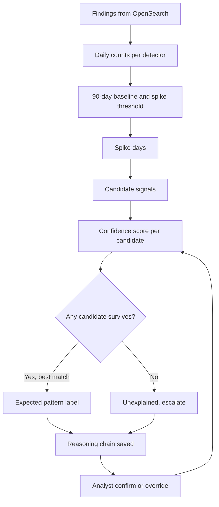

<div align="center">

# 🕰️ Temporal Context Engine

### Is that alert spike an attack, or just Ethiopia's calendar?

*My contribution to **Zemen (ዘመን)**, a Go tool that works alongside OpenSearch and Wazuh.*


</div>

---

## 👤 Author

| | |
|---|---|
| **Name** | Bekan Nura |
| **ID** | CTC-2623-26 |
| **Presentation video** | [▶ Watch on YouTube](https://youtu.be/VS5tdZsPS_k) |

---

## 📌 Table of contents

1. [The problem](#-the-problem)
2. [What the engine does](#-what-the-engine-does)
3. [How it works: the pipeline](#-how-it-works-the-pipeline)
4. [Step-by-step code walkthrough](#-step-by-step-code-walkthrough)
5. [The confidence formula](#-the-confidence-formula)
6. [The three labels](#-the-three-labels)
7. [Example output](#-example-output)
8. [Analyst feedback loop](#-analyst-feedback-loop)
9. [Repository contents](#-repository-contents)
10. [Tests](#-tests)
11. [Known limits](#-known-limits)
12. [About this repository](#-about-this-repository)

---

## ❓ The problem

Security detectors in Ethiopian organizations do not see a flat, uniform world. Alert volume rises around **Meskel, Timkat, Enkutatash, fasting seasons and salary days**, because people, systems and batch jobs behave differently on those days.

A generic SIEM sees a spike and raises an alarm. That leaves analysts with two bad options:

- investigate every holiday spike and waste hours, or
- learn to ignore spikes and miss a real attack hiding inside one.

## ✅ What the engine does

For every detector, the Temporal Context Engine:

1. **Finds** the days when the detector fired far above its own normal volume.
2. **Asks** whether that spike is explained by an Ethiopian calendar signal (holiday, fasting season, pay window), a custom signal, or a pattern learned from the organization's own history.
3. **Labels** the day and gives a **step-by-step reasoning chain** showing exactly how it decided.
4. **Learns** from analyst confirmations and overrides, so future confidence reflects real feedback.

When the evidence is weak, it says so and escalates instead of sounding sure.

---

## 🔄 How it works: the pipeline



---

## 🔍 Step-by-step code walkthrough

### Step 1: Turn findings into daily time series (`internal/stats`)

`Build` groups raw findings by detector and counts them per **local calendar day** (bucketed in the configured time zone). Each detector gets a `DetectorStats` with its daily counts, timestamps and first-seen day.

### Step 2: Define "far above normal" (`internal/stats`)

| Function | What it does |
|---|---|
| `BaselineBefore(day)` | Takes up to the **90 days before** a day (never earlier than the detector's first finding), **including quiet days**, and computes the mean and standard deviation. A quiet detector's normal really is mostly zeros. |
| `Threshold()` | A day is a spike at `mean + 3 x std`, or `2 x mean`, **whichever is higher**, and never below **5 findings**. The floor stops a detector averaging 0.1 findings a day from alarming on 1 or 2. |
| `IsSpike(count)` | A day is only judged if the baseline has at least **14 days** of history, so brand-new detectors do not produce false alarms. |
| `SpikeDays(from, to)` | Walks every day in a range and returns the spike days. |

Helper functions for the wider project: `EpisodeStarts` clusters findings into firing episodes (a burst of 500 findings in one minute counts as one), `GapHours` measures the time between episodes, and `Quantile` computes interpolated quantiles.

### Step 3: Build the calendar (`temporal.Run`)

`Run` loads and validates the custom calendar file (`calendar_custom.json`), loads the federated model, and generates every calendar **occurrence** (built-in Ethiopian holidays, fasting seasons, pay windows, plus custom signals) from the year before the oldest finding to next year. Each signal carries a **prior**: how likely it is to explain a spike before any local evidence exists.

### Step 4: Collect local evidence for each signal (`temporal.Run`)

For each detector and each **completed past occurrence** of a signal (after the detector has 14 days of history):

- **Trials** goes up by 1.
- **Hits** goes up by 1 if the detector spiked on at least one day inside that occurrence.
- The **volume multiplier** is recorded: average volume during the occurrence divided by the baseline before it.

This answers: *"Last time this holiday happened, did this detector actually spike?"*

### Step 5: Learn the organization's own patterns (`learnOverlays`)

Some spikes have nothing to do with holidays, such as a bank's recurring batch job. The engine tallies spikes by **day of the Gregorian month** and by **day of the Ethiopian month**, and creates a learned pattern when all of these hold:

- the detector spiked on that day-of-month **at least 3 times**,
- out of **at least 4** such days,
- at a **rate of at least 60%**, and
- **less than 70%** of those spike days are already explained by a calendar signal.

Learned patterns get signal IDs like `org-greg-dom-15` or `org-eth-dom-05`, start with a neutral prior of **0.5**, and are projected 400 days back and 120 days forward.

### Step 6: Label every recent spike day (`label`)

For each spike day, `label`:

1. Records the baseline, threshold and how many times normal the day was.
2. Collects **candidate signals** whose date range covers the day (calendar, custom, and this detector's learned patterns).
3. Scores each candidate with the confidence formula and sorts best-first.
4. **Rejects** candidates that expect a volume **drop** (a spike on a quiet day is itself suspicious) or whose confidence is **below the configured minimum**.
5. Picks the best survivor, or labels the day `unexplained_escalate` if none survive.
6. Writes the **reasoning chain**: baseline, ratio, matched signal, history, formula with real numbers, notes about approximate dates or default assumptions, and the alternatives it rejected.

### Step 7: Keep analyst decisions across runs (`applyRetained`)

If an analyst already confirmed or overrode a day, that decision is re-applied on the next run and recorded in the reasoning chain, so a re-run never erases human judgment.

### Step 8: Persist results (`persist`)

Everything is written in one bulk request to Zemen's OpenSearch indices: calendar occurrences and learned patterns, per-signal evidence stats, and the labeled contexts (`finding-context`).

---

## 🧮 The confidence formula

```
confidence = (hits + 2 x prior + confirms) / (trials + 2 + confirms + overrides)
```

The **prior counts as two imaginary past observations**. With little data the engine stays close to its prior and says so. As real history and analyst feedback accumulate, they take over.

**Worked examples from a real run:**

| Signal | Calculation | Confidence |
|---|---|---|
| Meskel | (2 + 2 x 0.50 + 0) / (2 + 2) = 3 / 4 | **0.75** |
| Learned pattern, day 15 of the month | (10 + 2 x 0.50 + 0) / (14 + 2) = 11 / 16 | **0.69** |
| Government salary window (default assumption) | too little evidence | **0.04**, rejected |

---

## 🏷️ The three labels

| Label | Meaning |
|---|---|
| `expected_local_pattern` | Explained by an Ethiopian calendar or custom signal |
| `expected_org_pattern` | Explained by a pattern learned from this organization's own data |
| `unexplained_escalate` | Nothing credible explains it, so investigate |

---

## 📟 Example output

Real output from `zemen anomalies -v`:

```
2026-09-28 (Meskerem 18, 2019 E.C.)  fim-event-detector  40 findings (5.1x)  expected_local_pattern  conf 0.75
    1. fim-event-detector had 40 findings on 2026-09-28 (Meskerem 18, 2019 E.C.). Its normal is 7.9/day
       (std 8.4 over 90 days); the spike threshold is 33.0, so this day is 5.1x normal.
    2. Matched calendar signal "Meskel (Finding of the True Cross)" (2026-09-26 to 2026-09-28;
       source: builtin; expected effect: mixed).
    3. History: in 2 of 2 earlier occurrences of this signal this detector also spiked (100%).
    4. Confidence 0.75 = (hits 2 + 2 x prior 0.50 + confirms 0) / (trials 2 + 2 + feedback 0).
       Label: expected_local_pattern.
```

And an example where the engine **refuses to explain** a spike:

```
2026-11-06 (Tikimt 27, 2019 E.C.)  network-event-detector  146 findings (7.0x)  unexplained_escalate  conf 0.00
    2. Signals covering this date were considered but rejected: "Government salary window
       (default assumption)" matched the date but confidence 0.04 is below the minimum 0.30. Escalate.
```

---

## 🔁 Analyst feedback loop

`ApplyFeedback` records a human decision on one detector-day:

| Action | Effect |
|---|---|
| `confirm` | Adds a confirmation to the matched signal, raising its confidence in future runs |
| `override --signal <id>` | Attributes the day to a different signal, sets confidence to 1 and counts a confirmation for that signal |
| `override` (no signal) | Rejects an explained label: the day becomes `unexplained_escalate` and the matched signal gets an override count |

Overriding a day that is already unexplained is refused unless the analyst names the signal that explains it.

---

## 📁 Repository contents

| Path | Purpose |
|---|---|
| `internal/temporal/temporal.go` | The engine: signal evidence, learned patterns, labeling, confidence, feedback, persistence |
| `internal/stats/stats.go` | Daily time series, 90-day baselines, spike threshold, spike days, episode helpers |
| `internal/stats/stats_test.go` | Unit test for spike detection, episodes and quantiles |

## 🧪 Tests

`stats_test.go` builds 40 normal days (2 findings each) followed by one burst of 40 findings in a single day, then checks that:

- **exactly one day** is flagged as a spike, and it is the burst day,
- episode clustering finds at least 40 episodes,
- the median quantile of `[1, 2, 3, 4, 5]` is `3`.

```bash
go test ./internal/stats
```

---

## ⚠️ Known limits

- The baseline uses a plain mean and standard deviation over 90 days, so earlier spikes stay in the window and slightly raise the baseline.
- Default pay-window signals are **assumptions**. Replace them with real dates in `calendar_custom.json`.
- Islamic holiday dates are approximate (±1-2 days), and the reasoning chain says so.
- With little history, confidence rests mostly on the prior, and the reasoning chain states that.

---

## 📎 About this repository

The Temporal Context Engine is **my contribution** to Zemen, a team project. I wrote the `temporal` and `stats` packages. This repository holds only that part, extracted for presentation.

It imports other Zemen packages (`config`, `ethcal`, `osclient`, `secanalytics`, `federated`, `indices`), so it **does not build on its own**. To run the full system, see the team repository:

👉 **https://github.com/Yohannes-Negero/zemen**
